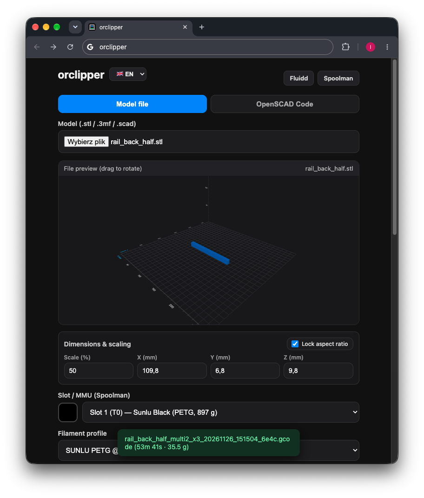
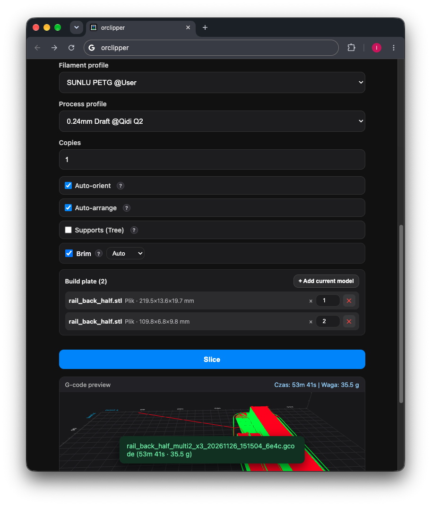
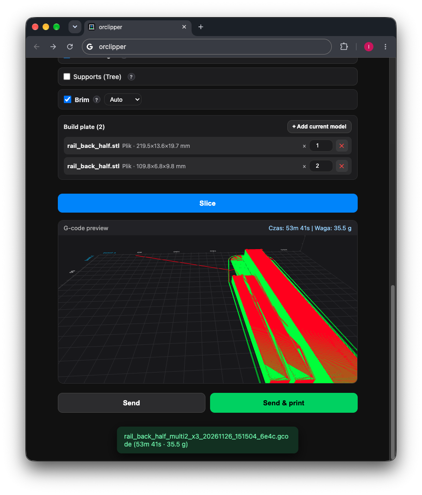
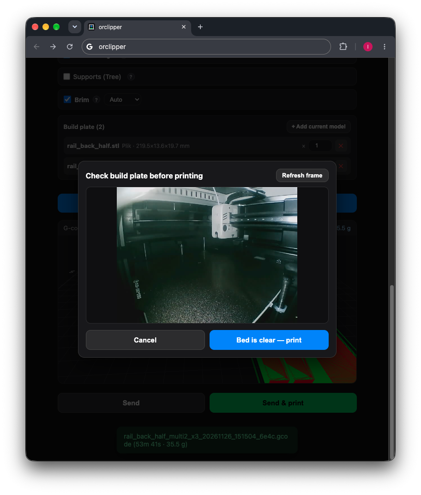

# orclipper

Lightweight, printer-agnostic, self-hosted web UI for slicing `.stl`, `.3mf`, and OpenSCAD (`.scad`) models with headless **OrcaSlicer CLI** and sending G-code directly to any **Klipper / Moonraker** 3D printer.

## Features

- **File & OpenSCAD input:** Upload `.stl` / `.3mf` / `.scad` files or write OpenSCAD code directly in the browser with live 3D preview.
- **Server-side `.3mf` preview fallback:** Automatically converts Bambu/Orca Production Extension `.3mf` files to binary STL for browser preview.
- **3D model & G-code viewers:** Interactive Three.js previews with a **layer slider** for inspecting sliced G-code layer by layer.
- **Automatic build plate sizing:** Reads `printable_area` directly from `profiles/machine.json` to scale the 3D viewport grid (supports both square and rectangular beds).
- **On-the-fly slicing options:**
  - Real-time XYZ dimensioning & uniform or per-axis scaling.
  - Multi-copy object duplication (`1–100` copies with automatic bed arrangement).
  - Toggleable auto-orientation, auto-arrangement, Tree supports, and 5 mm brim.
- **Optional Spoolman / MMU integration:** Fetches active filament slots and color swatches from Spoolman and matches filament profiles automatically. Leave `SPOOLMAN_URL` empty to hide and disable this section.
- **Pre-print camera check:** Displays a live camera snapshot modal proxied through Moonraker before starting a print so you can verify the build plate is clear.
- **Dynamic profile discovery:** Drop flattened OrcaSlicer JSON profiles into `profiles/process/` or `profiles/filament/` — no container restart needed.

## Screenshots

| | |
| --- | --- |
|  |  |
|  |  |# Orclipper

Web slicer interface for OrcaSlicer integrated with Moonraker / Fluidd / Mainsail.

---

## 1) Script installation

> **Note on `aarch64` / older Linux hosts (e.g. Klipper boards):** Official OrcaSlicer Linux AppImage builds target `x86_64`. On `aarch64` or older `glibc` systems, provide a compatible local `orca-slicer` binary path when prompted or run Orclipper on an `x86_64` host/container.

One interactive script handles installation, updates, `.3mf` profile import, and clean uninstallation (tracking only newly installed APT packages in `/opt/orclipper/.install-manifest` and running with `systemd` resource limits when available).

### macOS / Linux / WSL


#### 1a) Remote mode (from your computer to a printer or remote Linux host over SSH)

Run on your local machine (Linux, macOS, or WSL):

```bash
curl -fsSL https://raw.githubusercontent.com/sebastianowy/orclipper/refs/heads/main/run.sh | bash
```

1. Choose **Install / Update Orclipper** (or **Import profiles from .3mf** / **Uninstall Orclipper**).
2. Choose **Remote host via SSH**, then enter the target host IP/hostname, SSH user, and SSH port.
3. The script installs and configures Orclipper on the remote host.

#### 1b) Local mode (directly on the machine or printer)

Run directly on the target machine/printer:

```bash
curl -fsSL https://raw.githubusercontent.com/sebastianowy/orclipper/refs/heads/main/run.sh | bash
```

1. Choose **Install / Update Orclipper** (or **Import profiles from .3mf** / **Uninstall Orclipper**).
2. Choose **This machine (local)** and confirm port, profiles directory, and detected/entered URLs.

### Windows

**Windows (PowerShell, remote mode only — requires built-in OpenSSH Client):**

```powershell
irm https://raw.githubusercontent.com/sebastianowy/orclipper/refs/heads/main/run.ps1 | iex
```

1. Choose **Install / Update Orclipper** (or **Import profiles from .3mf** / **Uninstall Orclipper**).
2. Choose **Remote host via SSH** (on Linux/macOS/WSL; Windows runs in remote mode directly), then enter the target host IP/hostname, SSH user, and SSH port.
3. The script installs and configures Orclipper on the remote host

### Profiles in script mode

* **Import from `.3mf`:** Run the script, choose **Import profiles from .3mf**, and provide the path to a `.3mf` file (in `remote` mode the file is streamed from your computer over SSH; in `local` mode it is extracted directly on the host).
* **Existing `.json` profiles:** Place flattened `.json` profiles directly in the configured profiles directory (default: `/opt/orclipper/profiles`).

---

## 2) Docker installation (and `.env` configuration)

Use Docker when running Orclipper in containers or on a separate server/homelab host. Unlike the host script, Docker deployments use a `.env` file to configure runtime environment variables.

### Setup with `.env`

1. Create a `.env` file next to `docker-compose.yml`:

```bash
cp .env.dist .env
```

2. Build and start the service:

```bash
docker compose up -d --build
```

### Profiles in Docker mode

* **Extract profiles from `.3mf` via Compose (`tools` profile):** Put your `.3mf` file(s) inside `./profiles/` and run:

```bash
docker compose run --rm extract-profiles
```

* **Alternative — stream `.3mf` over `stdin` without placing the file in `./profiles/`:**

```bash
docker exec -i orclipper python3 /app/extract_profiles.py - < project.3mf
```

* **Manual `.json` profiles:** Drop flattened profile `.json` files directly into `./profiles/` (mounted to `/profiles`).

## Notes

- `.gcode.3mf` files contain pre-sliced G-code without 3D mesh geometry and are rejected by `/slice` — use raw `.3mf` or `.stl` files instead.

---

## How to get a `.3mf` file with profiles

1. Open **OrcaSlicer** on your computer.
2. Select the **Printer**, **Filament**, and **Process** profiles you want to use in Orclipper.
3. Place any model on the build plate (even a simple test shape) so the project has a complete profile snapshot.
4. Save the project via **File -> Save Project as...** (`Ctrl+S` / `Cmd+S`) as a `.3mf` file (e.g. `profiles.3mf`).
5. Pass that `.3mf` file to the run script (import option) or the Docker `extract-profiles` tool.
